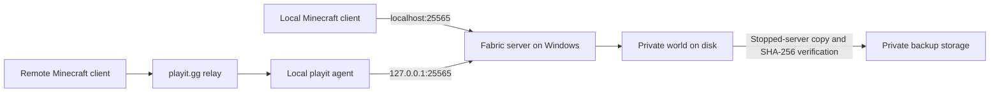

# Minecraft Fabric Server

A Windows-hosted, two-player Minecraft Java survival server: an existing Aternos world, Fabric, and a playit.gg tunnel connecting friends in different homes. This repository records the build and supplies conservative management scripts. The world and runtime stay outside Git.

**Start here: [How I made my server — ten-step walkthrough](docs/how-i-built-it.md).** This follows the owner's setup notes, from creating the folder to connecting a friend, with safer reproduction instructions where needed.

## Build story and verified baseline

The owner installed Temurin, installed Fabric, allocated a 4 GB server heap, moved an existing world from Aternos, configured a whitelist and Hard difficulty, and tested remote play through playit.gg. World progress and successful multiplayer are owner-reported; no gameplay test was performed while preparing this repository.

Read-only local inspection on 2026-10-11 confirmed:

| Component | Existing setup |
| --- | --- |
| Host | Windows 11; Intel Core i5 13th Gen; RTX 4060; 16 GB RAM; 1 TB storage (owner supplied) |
| Minecraft / Fabric Loader | 26.3 / 0.19.5, from installed filenames |
| Java | Temurin 25.0.4.1, verified with `java -version` |
| Server heap | 2 GB initial, 4 GB maximum |
| Client heap / regular players | 6 GB / 2 (owner supplied) |
| World | Existing `world` directory |
| Gameplay | Hard; spawn protection 0; whitelist enabled |
| Existing limits | 20 maximum players; view and simulation distances both 10 |
| Server mods | `mods` directory empty at inspection |
| Authentication | `online-mode=false`; `enforce-whitelist=false` |

**The existing offline-mode server allows username impersonation, including impersonation of an operator. A whitelist does not authenticate a player.** Read [security](docs/security.md) before using a public tunnel. This repository never grants OP or changes authentication automatically. Its example uses authenticated accounts and differs deliberately from the existing private configuration.

## Architecture



Shaders run in the client on the GPU. Server ticks run on the host CPU. The relay supplies connectivity, not Minecraft account authentication.

## Prerequisites and first use

Windows 11, Windows PowerShell 5.1 or PowerShell 7, Temurin JDK 25 with `JAVA_HOME`, Git, and a separately installed Fabric 26.3 / Loader 0.19.5 server. Download runtime files from their official publishers. Accept the Minecraft EULA yourself after reading it; no script accepts it for you.

For a new computer, follow [installation](docs/installation.md). For the existing installation, keep this repository separate and run from the repository root:

```powershell
# Read-only prerequisite check; does not start Java Minecraft.
.\scripts\start.ps1 -ServerDir 'C:\Minecraft-Server' -CheckOnly
# Start only during your normal maintenance/play session.
.\scripts\start.bat -ServerDir "C:\Minecraft-Server"
# Optional heap configuration (defaults are 2 and 4).
.\scripts\start.ps1 -ServerDir 'C:\Minecraft-Server' -MinMemoryGB 2 -MaxMemoryGB 4
```

Type `stop` in the server console for graceful shutdown. `stop.ps1` prints that instruction and waits for shutdown; it cannot inject commands into an existing console. It does not kill processes or enable RCON.

```powershell
.\scripts\stop.ps1 -ServerDir 'C:\Minecraft-Server'
# Create private backup storage outside both runtime and repository first.
New-Item -ItemType Directory -Path 'C:\Minecraft-Backups'
.\scripts\backup.ps1 -ServerDir 'C:\Minecraft-Server' -BackupRoot 'C:\Minecraft-Backups'
# Substitute a completed backup directory returned by backup.ps1.
.\scripts\restore.ps1 -ServerDir 'C:\Minecraft-Server' -BackupPath 'C:\Minecraft-Backups\BACKUP-ID' -WhatIf
.\scripts\restore.ps1 -ServerDir 'C:\Minecraft-Server' -BackupPath 'C:\Minecraft-Backups\BACKUP-ID'
```

Restore requires confirmation and typing `RESTORE`; it retains the previous world. See [backup and restore](docs/backup-restore.md) for limits and recovery.

## Safety contract

- Scripts require an explicit runtime directory. They never copy this example over a real configuration.
- Startup and maintenance share an exclusive management lock. Any running `java` or `javaw` process blocks startup/backup/restore, conservatively including clients. Start the server before the client.
- Stop the server and disable external automatic restarts before maintenance. Other launchers do not honor our management lock; concurrent external startup is unsupported.
- Backups are full, timestamped world snapshots with verified hashes. No automatic deletion or retention policy runs.
- Symlinks/junctions and complex world paths are rejected. `level-name` must use letters, digits, underscores or hyphens.
- Backup/restore can temporarily need several world-sized copies. Check free disk space first.

## Documentation

| Guide | Covers |
| --- | --- |
| [Installation](docs/installation.md) | Fresh-machine setup |
| [Java](docs/java-setup.md) / [Fabric](docs/fabric-setup.md) | Runtime and loader |
| [World migration](docs/world-migration.md) | Aternos export and player identity |
| [Backup and restore](docs/backup-restore.md) | Stopped-server snapshots and rollback |
| [Mods](docs/mods.md) | Client/server roles and compatibility |
| [Networking](docs/networking.md) | Local, tunnel and remote connections |
| [Security](docs/security.md) | Authentication and cheating risks |
| [Performance](docs/performance.md) | TPS, memory and rubberbanding |
| [Troubleshooting](docs/troubleshooting.md) | Symptom-to-check mapping |
| [Testing](docs/testing.md) / [Publishing](docs/publishing.md) | Validation and privacy review |

## Validation

```powershell
powershell.exe -NoProfile -File .\tests\validate-config.ps1
powershell.exe -NoProfile -File .\tests\test-scripts.ps1
```

Tests use synthetic worlds in temporary directories, never the real server. Windows CI repeats these checks. Live start/stop, real-world restore and multiplayer are manual acceptance checks, not automated test claims.

MIT license covers this repository's original scripts and documentation only. Minecraft, Fabric, mods and shader packs retain their own licenses. Not affiliated with Mojang or Microsoft.
